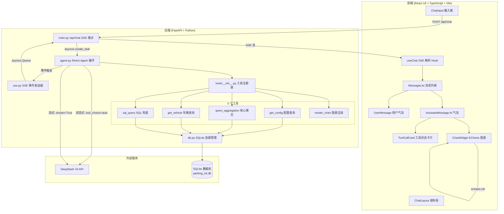
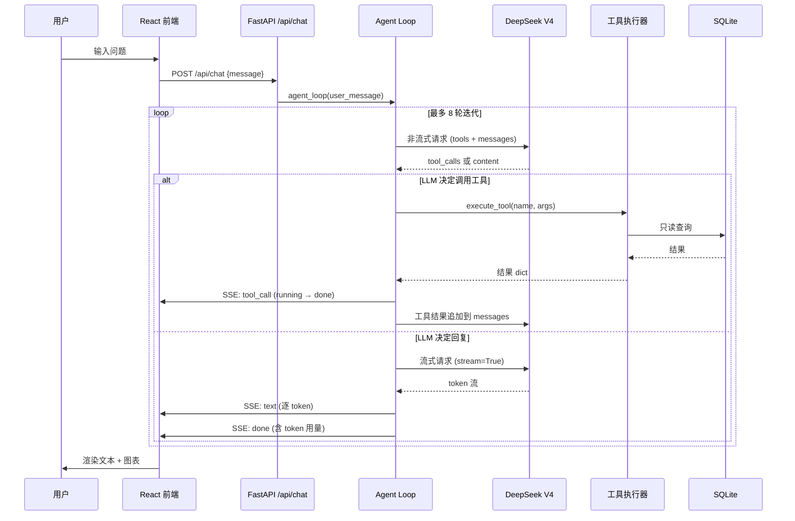
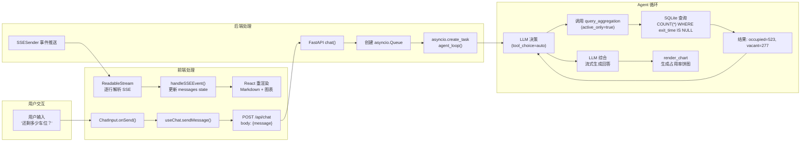

# ParkingLotDS — 项目概述

> 停车场 AI Agent 仿真演示系统  
> 基于 DeepSeek V4 · FastAPI + React + ECharts · SQLite

---

## 1. 项目定位

ParkingLotDS 是一个**全栈 AI Agent 仿真系统**，模拟一个拥有 800 个车位的停车场。用户通过自然语言向系统提问（"还剩多少车位？""新能源车占比？""最近一周趋势？"），后端的 ReAct Agent 自动选择工具查询 SQLite 数据库，并以 **文本 + ECharts 图表** 的混合形式流式返回答案。

核心验证点：
- AI Agent 自主决策：理解问题 → 选工具 → 执行 → 综合回答
- 多模态回答：Markdown 文本与图表同框
- 流式体验：逐 token 输出 + 工具执行过程可视化
- 本地数据闭环：SQLite + 参数化工具 + 受控 SQL

---

## 2. 架构总览



---

## 3. 目录结构

```
ParkingLotDS/
├── backend/                    # Python 后端
│   ├── main.py                 # FastAPI 入口：POST /api/chat (SSE)、GET /api/health
│   ├── agent.py                # ReAct Agent 循环：LLM 决策 ↔ 工具执行 ↔ 流式响应
│   ├── config.py               # 环境变量加载 (DeepSeek API Key、模型、数据库路径)
│   ├── db.py                   # SQLite 连接管理 (WAL 模式、只读/读写上下文、Schema 初始化)
│   ├── sse.py                  # SSE 事件格式化与发送 (tool_call / text / chart / done / error)
│   ├── models.py               # Pydantic 请求/响应模型
│   ├── data_generator.py       # 一次性脚本：生成 120 天模拟停车数据 (~115K 条记录)
│   ├── requirements.txt        # Python 依赖
│   └── tools/                  # Agent 工具集
│       ├── __init__.py         # 工具注册表：TOOL_SCHEMAS + TOOL_EXECUTORS
│       ├── aggregation.py      # T2: query_aggregation — 核心参数化聚合 (替代旧 6 个工具)
│       ├── parking.py          # T1: get_config + T3: get_vehicle
│       ├── sql_tool.py         # T4: sql_query — 受控只读 SQL 兜底
│       └── chart_tool.py       # T5: render_chart — ECharts 图表验证与自动修复
│
├── frontend/                   # React 前端
│   ├── src/
│   │   ├── main.tsx            # React 18 入口
│   │   ├── App.tsx             # 根组件：ThemeProvider → ChatLayout
│   │   ├── index.css           # Tailwind 全局样式 + 自定义 CSS 变量
│   │   ├── components/
│   │   │   ├── ChatLayout.tsx  # 根布局：Header + MessageList + QuickQuestions + ChatInput
│   │   │   ├── Header.tsx      # 顶栏：标题 + 主题切换
│   │   │   ├── MessageList.tsx # 消息列表：智能滚动 (用户上滚时不自动追底)
│   │   │   ├── UserMessage.tsx # 用户消息气泡
│   │   │   ├── AssistantMessage.tsx # AI 消息：Markdown 渲染 + 工具卡片 + 图表
│   │   │   ├── ToolCallCard.tsx # 工具执行状态卡片 (running → done/error 动画)
│   │   │   ├── ChartWidget.tsx # ECharts 图表：主题适配 (深色/浅色)、自动 resize
│   │   │   ├── ChatInput.tsx   # 输入框：发送/停止、Shift+Enter 换行
│   │   │   ├── QuickQuestions.tsx # 快捷提问按钮
│   │   │   ├── EmptyState.tsx  # 空白欢迎页
│   │   │   └── ThemeToggle.tsx # 深色/浅色切换
│   │   ├── hooks/
│   │   │   ├── useChat.ts      # SSE 流式解析 Hook：POST → ReadableStream → 事件分发
│   │   │   └── useTheme.tsx    # 主题 Context + localStorage 持久化
│   │   └── types/
│   │       └── chat.ts         # TypeScript 类型定义
│   ├── index.html
│   ├── vite.config.ts          # Vite 配置：代理 /api → localhost:8000
│   ├── tailwind.config.js      # Tailwind 自定义颜色/动画
│   └── package.json
│
├── data/                       # SQLite 数据库文件 (gitignored)
│   └── parking_lot.db
│
├── docs/                       # 文档
│   ├── SPEC.md                 # 技术规范 (914 行，数据模型/工具体系/SSE 协议/前端状态)
│   ├── overview.md             # 本文档
│   ├── goal.md                 # 项目目标与需求
│   ├── table.md                # 数据表说明
│   ├── tools.md                # 工具体系设计
│   ├── toolsDesign.md          # 工具设计原则
│   ├── toolBoundary.md         # sql_query 与预定义工具的边界
│   └── llmSQL.md               # LLM 生成 SQL 的能力评估
│
├── .env.example                # 环境变量模板
├── AGENTS.md                   # AI 助手指引 (本项目的 "说明书")
└── README.md                   # 项目 README
```

---

## 4. 核心模块详解

### 4.1 后端 Agent 循环 (`agent.py`)

ReAct (Reasoning + Acting) 循环是系统的智能核心：



关键实现细节：
- **工具决策阶段**使用非流式调用（工具需要完整 JSON）
- **文本响应阶段**使用流式调用（核心 UX 体验）
- `reasoning_content` 按 DeepSeek V4 要求原样回传
- 最大 8 轮 ReAct 迭代，防止无限循环
- 典型的 2-3 轮完成：问 → 查 → 答

### 4.2 工具体系 (`tools/`)

从原来的 9 工具精简为 **5 工具**（v2，2026-06-10）：

| 工具 | 文件 | 功能 | 覆盖场景 |
|------|------|------|----------|
| `get_config` | `parking.py` | 获取停车场全局配置（总车位/楼层/费率） | 上下文查询 |
| `query_aggregation` | `aggregation.py` | **核心工具**：参数化聚合查询 | 覆盖 90% 场景 |
| `get_vehicle` | `parking.py` | 按车牌查询车辆详情 | 个体查询 |
| `sql_query` | `sql_tool.py` | 受控只读 SQL（兜底） | 二维交叉分组等 |
| `render_chart` | `chart_tool.py` | 生成 ECharts 图表 | 数据可视化 |

`query_aggregation` 是设计核心。通过 `active_only` + `group_by` + `date_from/date_to` + `include_duration` 四个参数的正交组合，一个工具替代了旧版 6 个独立工具：

```
query_aggregation(active_only=true)                        → 当前空余车位 (旧 T1)
query_aggregation(active_only=true, group_by="vehicle_type") → 车辆类型分布 (旧 T2)
query_aggregation(active_only=true, group_by="floor")       → 楼层占用状态 (旧 T4)
query_aggregation(active_only=false, group_by="date")       → 每日趋势 (旧 T3)
query_aggregation(active_only=false, group_by="hour")       → 时段分布 (旧 T5)
query_aggregation(active_only=false, include_duration=true) → 汇总统计 (旧 T7)
query_aggregation(active_only=false, group_by="day_of_week")→ 星期分布 (新增)
query_aggregation(active_only=false, group_by="month")      → 月度汇总 (新增)
```

设计原则（来自 `docs/toolsDesign.md`）：
- **操作原语驱动**：每个参数对应一个正交的查询维度
- **参数化扩展**：新功能只需加 `group_by` 枚举值
- **统一返回结构**：所有路径返回相同 JSON schema
- **内置派生指标**：ratio、occupancy_rate、rolling_avg_7d 由工具计算

### 4.3 数据库 (`db.py` + `data/`)

SQLite 单文件数据库，WAL 模式：

```
parking_lot_config          vehicle_record
├── id (PK, =1)             ├── id (PK, AUTOINCREMENT)
├── name                    ├── plate (车牌号)
├── total_spots (=800)      ├── vehicle_type (ICE/BEV/PHEV/HEV)
├── floors (=4)             ├── entry_time (进场时间)
├── spots_per_floor (=200)  ├── exit_time (离场时间, NULL=在场)
└── hourly_rate (=6.0)      ├── entry_floor (进场楼层)
                            └── entry_spot (车位号)
```

关键设计：
- **`exit_time IS NULL`** = 车辆当前在场，这是所有 "当前状态" 查询的核心谓词
- 部分索引 `idx_active ON vehicle_record(entry_time) WHERE exit_time IS NULL` 加速在场查询
- `get_db(read_only=True)` 对所有工具查询使用只读连接 + `PRAGMA query_only=ON`
- 数据由 `data_generator.py` 一次性生成：120 天、~115K 条记录、泊松到达 + 指数停车时长

### 4.4 SSE 流式协议 (`sse.py`)

前后端通过 **SSE (Server-Sent Events)** 实现实时推送，协议包含 5 种事件：

| 事件类型 | 方向 | 数据结构 | 触发时机 |
|----------|------|----------|----------|
| `tool_call` | 后端→前端 | `{tool_name, status, arguments?, result_preview?, error?}` | 工具开始执行/完成/出错 |
| `text` | 后端→前端 | `{token}` | LLM 逐 token 输出 |
| `chart` | 后端→前端 | `{chart_id, chart_type, option}` | render_chart 成功后 |
| `done` | 后端→前端 | `{status, usage?}` | 流结束 |
| `error` | 后端→前端 | `{code, message, retryable}` | 异常 |

实现方式：
- 后端使用 `asyncio.Queue` 作为事件总线
- `SSESender` 封装 `queue.put(format_sse(event, data))`
- 前端 `useChat` 通过 `ReadableStream` 手动解析 `event:` / `data:` 行对（不用 `EventSource`，因为需要 POST 请求）
- Vite 开发代理：`/api` → `http://localhost:8000`

---

## 5. 数据流全景

一次完整对话的数据流：



---

## 6. 关键技术决策

| 决策 | 选择 | 理由 |
|------|------|------|
| Agent 框架 | 手写 ReAct Loop | 工具数 < 10，手写比 LangChain 更透明可控 |
| LLM 调用 | OpenAI SDK → DeepSeek | DeepSeek 兼容 OpenAI 协议，`base_url` 切换即可 |
| 工具决策 | 非流式 | 工具需要完整 JSON，流式解析碎片化 JSON 风险高 |
| 文本响应 | 流式 | 核心 UX 体验，逐 token 渲染 |
| 数据库 | SQLite + WAL | 零配置，单文件，足够支撑 Demo 级查询 |
| 图表方案 | LLM 直接生成 ECharts option | 跳过了中间 DSL 层，减少映射损耗 |
| 前后端通信 | SSE (POST) | 比 WebSocket 更简单，单向推送即可满足需求 |
| 样式 | Tailwind CSS | AI 友好的 utility class，快速出 UI |
| 数据生成 | 泊松分布 + 指数分布 | 模拟真实停车场到达和停留行为 |
| 工具精简 | 6→1 聚合工具 | 减少 LLM 工具选择负担，提高决策准确率 |

---

## 7. 快速启动

```bash
# 后端
cd backend
pip install -r requirements.txt
python data_generator.py          # 首次：生成模拟数据
uvicorn main:app --reload --port 8000

# 前端 (新终端)
cd frontend
npm install
npm run dev                       # → http://localhost:5173
```

环境变量配置（`.env`）：
```
DEEPSEEK_API_KEY=sk-xxx
DEEPSEEK_MODEL=deepseek-v4-pro
DATABASE_PATH=../data/parking_lot.db
THINKING_MODE=enabled
```

---

## 8. 相关文档索引

| 文档 | 内容 |
|------|------|
| `docs/SPEC.md` | 完整技术规范（914 行）：数据模型、工具体系、SSE 协议、前端状态管理 |
| `docs/tools.md` | 工具体系设计思路与演进 |
| `docs/toolsDesign.md` | 工具设计原则：操作原语、参数化扩展、统一返回结构 |
| `docs/toolBoundary.md` | `sql_query` 与预定义工具的职责边界 |
| `docs/llmSQL.md` | LLM 生成 SQL 的能力评估与示例 |
| `docs/goal.md` | 项目目标与需求访谈记录 |
| `AGENTS.md` | AI 助手操作指引（模块说明、模式、注意事项） |
| `README.md` | 项目 README（对外） |
